<div align="center">

# Safis

**An agent skill that teaches an idea by building it as a page you can drag, turn, and cut open.**<br>
Runs in Claude Code, Codex, OpenCode, Cursor, and other agents that read Agent Skills.<br>
Long-form explainers with live 2D, 3D, isometric, map, optics, and sound figures, in one HTML file that opens from disk.

[](#install)
[](https://agentskills.io)
[](LICENSE)
[](#requirements)
[](#how-it-works)
[](https://github.com/broisnees/safis/actions/workflows/ci.yml)

[](https://safis.fyi)
[](https://github.com/broisnees/safis/archive/refs/heads/main.zip)
[](#install)

[Quick start](#quick-start) · [Gallery](#gallery) · [What it makes](#what-it-makes) · [Install](#install) · [Usage](#usage) · [How it works](#how-it-works) · [Limits](#limits)

<a href="https://safis.fyi"></a>

</div>

## Quick start

```
npx skills add broisnees/safis -g
```

The installer asks which agents to set up. Then ask for a page:

```
/safis how a turbofan makes thrust
```

Or just say what you want to understand ("make me an interactive page on why the sky is blue") and the agent picks the skill up. It plans the page, builds it section by section, checks every figure in headless Chrome, plays with each one to confirm it shows what the text claims, fixes what doesn't, and reports back with the file path.

## Gallery

Every page in [`site/`](site) was built with the skill. Open the [live site](https://safis.fyi), or `site/index.html` straight from disk.

| | | |
|:-:|:-:|:-:|
| [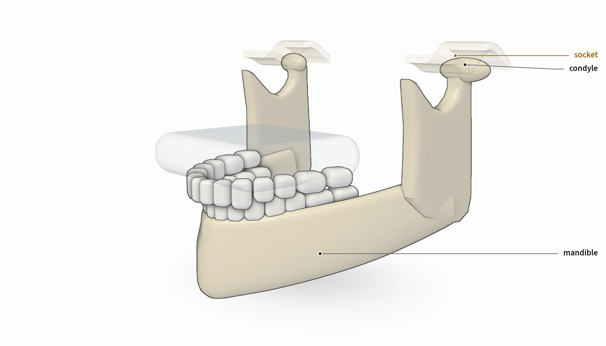](https://safis.fyi/jaw-joint/)<br>**The jaw joint** | [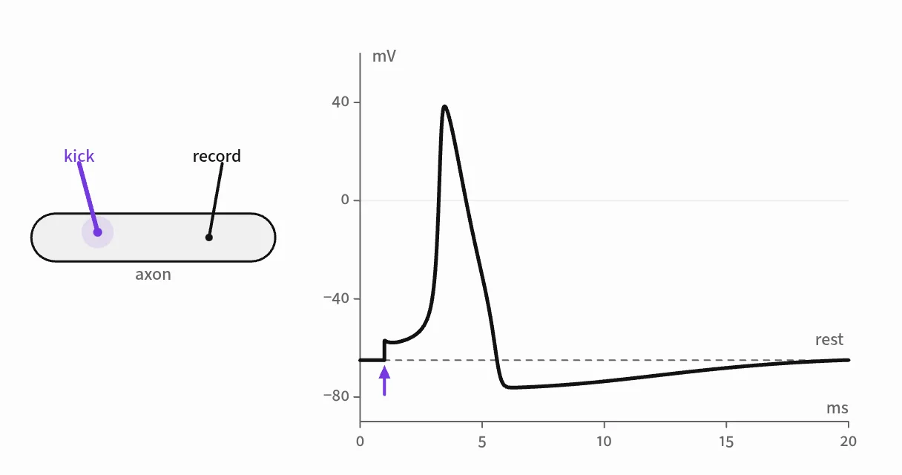](https://safis.fyi/neuron/)<br>**How a neuron fires** | [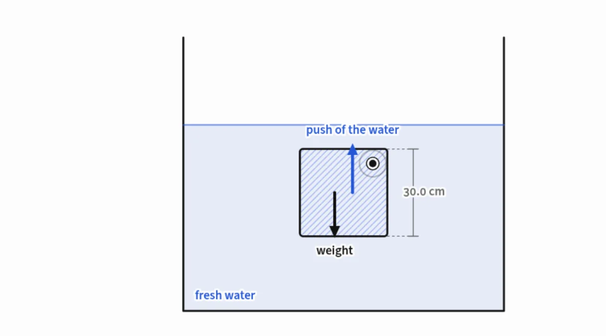](https://safis.fyi/ice/)<br>**Why ice floats** |
| [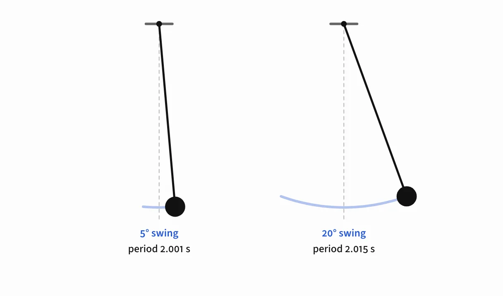](https://safis.fyi/pendulum/)<br>**How a pendulum keeps time** | [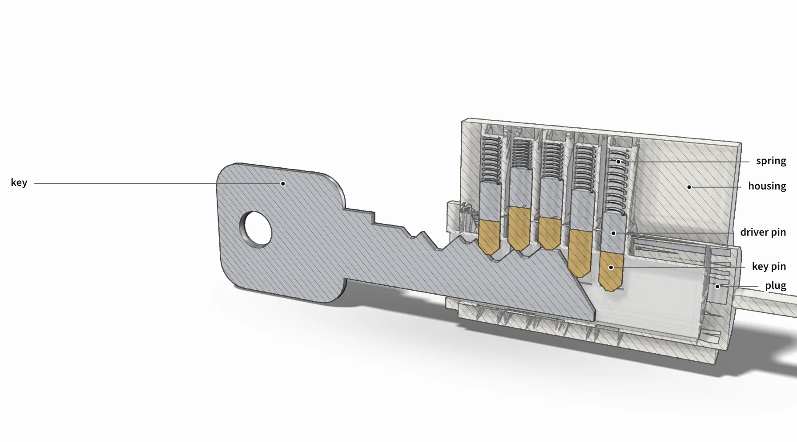](https://safis.fyi/lock/)<br>**How a pin tumbler lock works** | [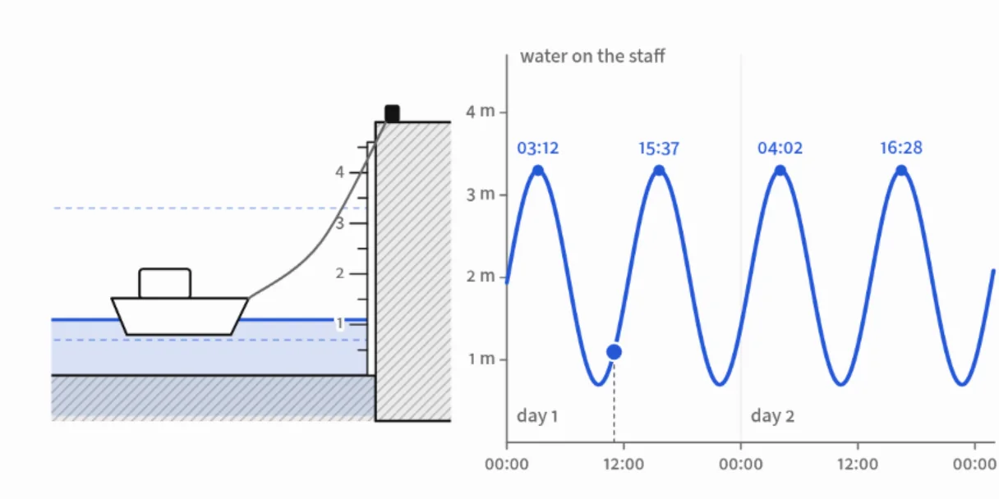](https://safis.fyi/tides/)<br>**Why there are two tides a day** |
| [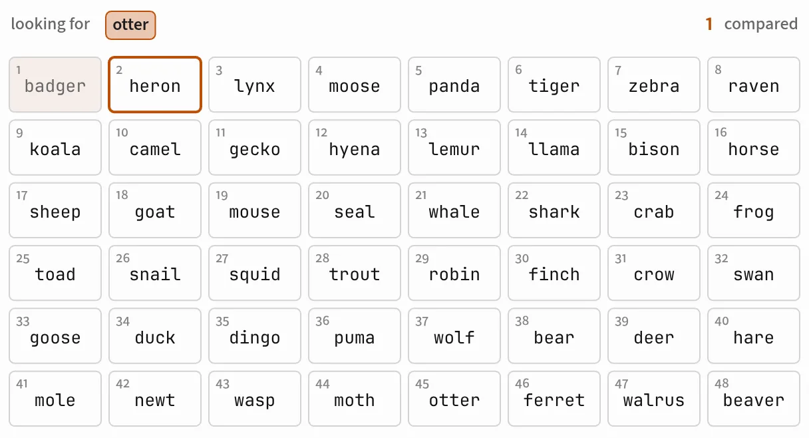](https://safis.fyi/hash-table/)<br>**How a hash table finds things** | [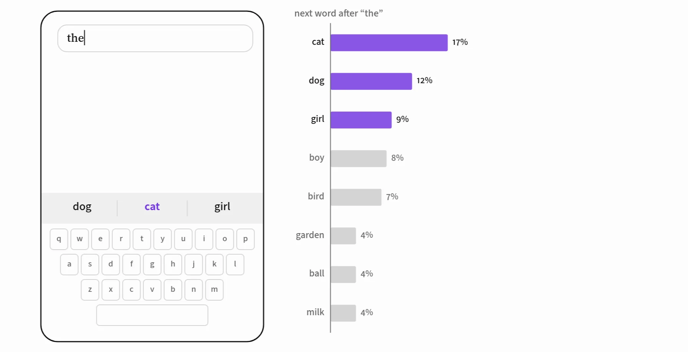](https://safis.fyi/next-word/)<br>**How a language model picks the next word** | [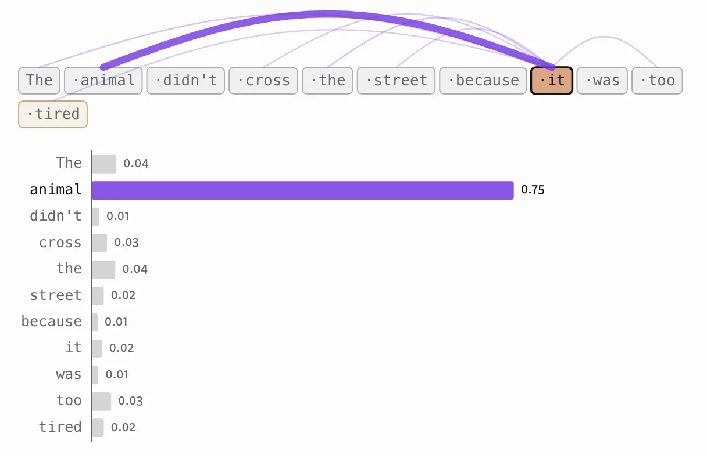](https://safis.fyi/attention/)<br>**How attention works** |
| [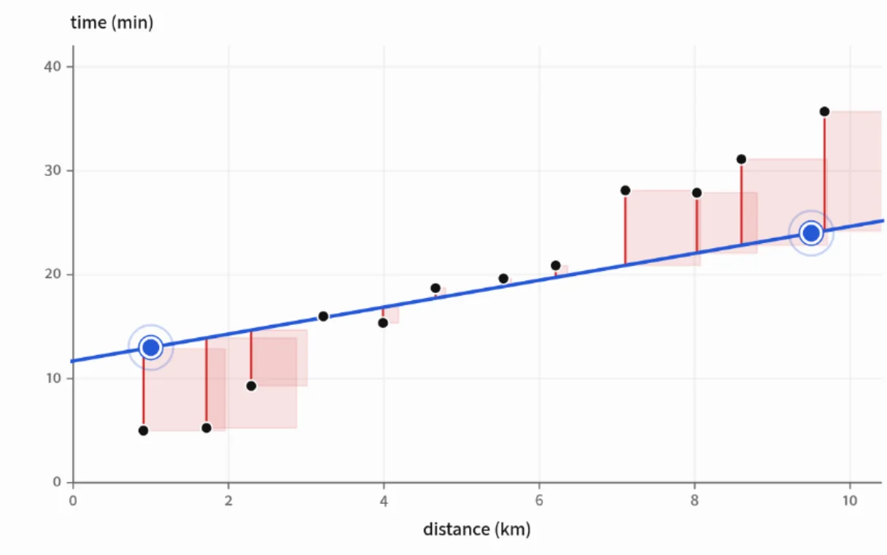](https://safis.fyi/learning/)<br>**How a neural network learns** | [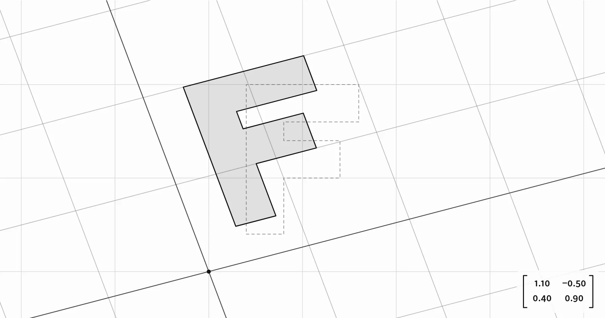](https://safis.fyi/matrix/)<br>**How a matrix transforms space** | [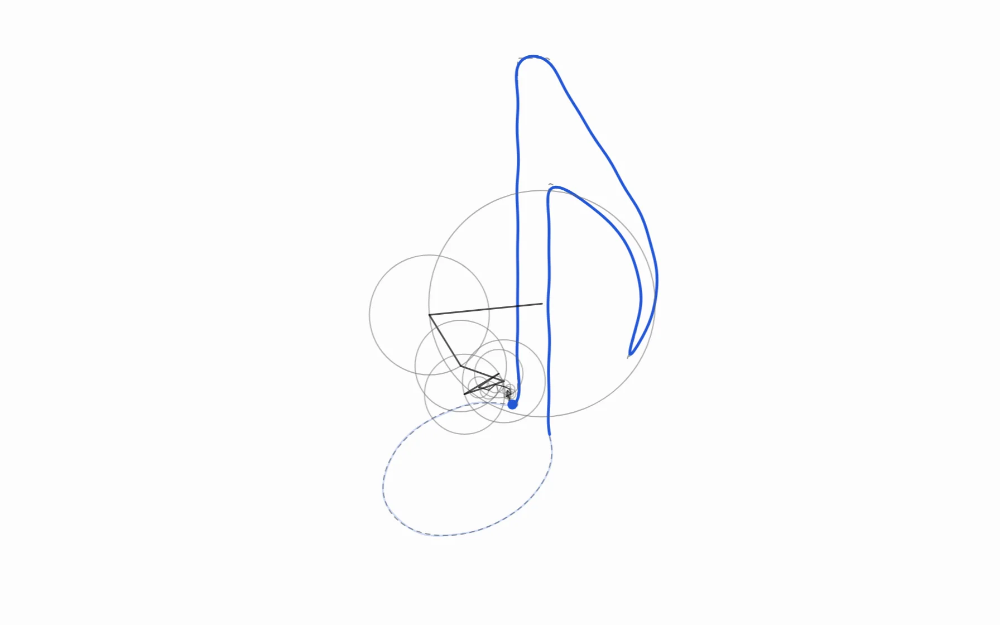](https://safis.fyi/fourier/)<br>**How spinning circles draw anything** |
| [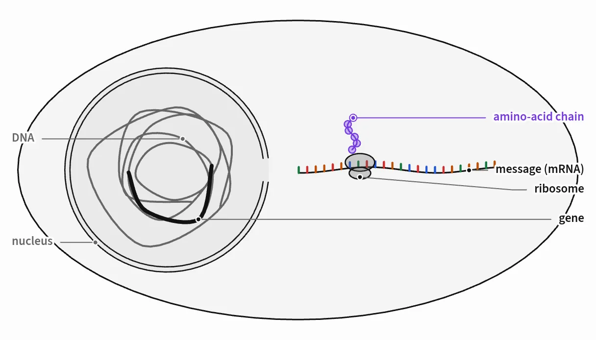](https://safis.fyi/protein/)<br>**How a cell builds a protein** | [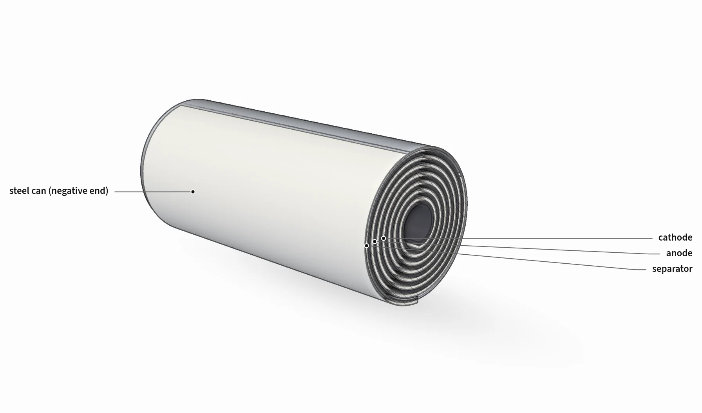](https://safis.fyi/battery/)<br>**The lithium-ion battery** | [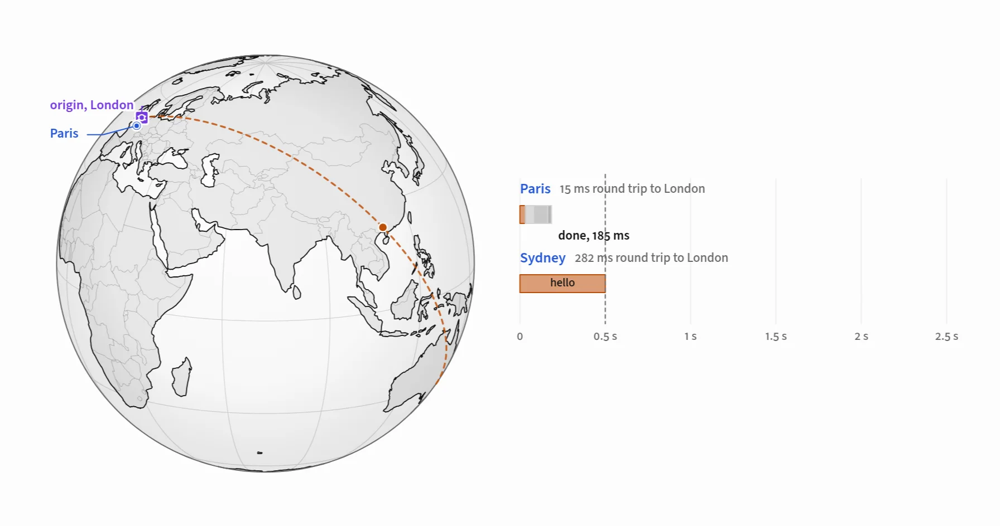](https://safis.fyi/cdn/)<br>**How a CDN makes a faraway site fast** |
| [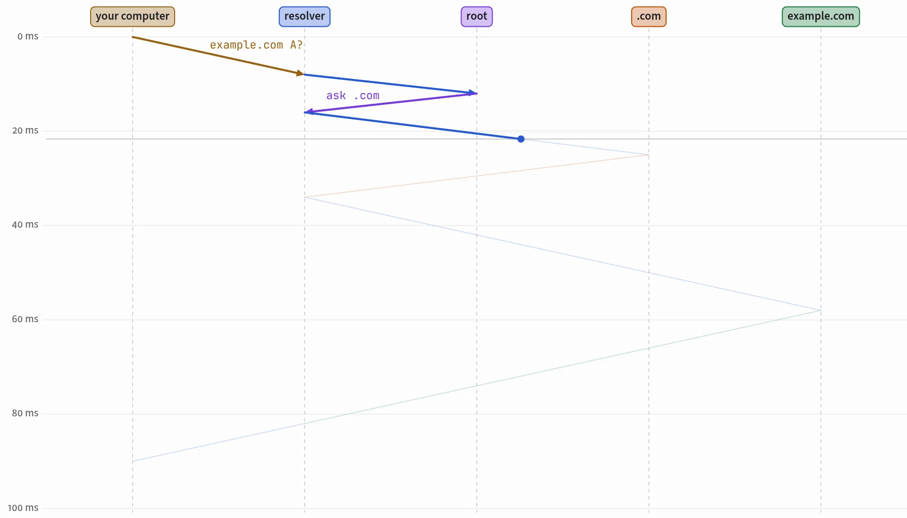](https://safis.fyi/dns/)<br>**How DNS turns a name into an address** | | |

## What it makes

One page per topic: a question in the title, an abstract, 7-12 numbered sections, and about 25 figures woven into the prose. Each figure has one idea and something to move. Sentences say what to try, the figure lets the reader try it, and the next paragraph names what they saw.

| Figure kind | What it draws | Good for |
|---|---|---|
| **2D canvas** | Cross-sections, graphs, fields, simulations, step-throughs, with sliders, knobs, XY pads, presets, dragging, and hover readouts | Mechanisms, physics, algorithms, data |
| **3D** | A small WebGL 2 engine: porcelain shading, ink outlines, section cuts with hatching, see-through parts, orbiting with momentum | Shapes that must turn freely, molecules, surfaces |
| **Isometric illustration** | Machines from many small solid parts with four-tone shading, painted back to front, cut away, see-through, and exported as a standalone SVG | Engines, instruments, devices, the hero figure |
| **Effects** | Fire and exhaust, smoke and steam, airflow streaks, ripples and caustics, glow, sparks, arcs, drawn with WebGL inside a figure | Showing what lines can't: heat, flow, light |
| **Maps** | World maps and globes in five projections, countries, cities, great-circle routes, distances | Networks, earthquakes, tides, travel |
| **Optics** | Rays through mirrors, lenses, prisms, raindrops, and the eye, with Fresnel reflection and dispersion | Rainbows, cameras, glasses, fiber |
| **Sound and images** | Tones and plucked strings the reader hears, spectra; pixels, filters, aliasing, dithering, the DCT | Music, audio, photography, compression |
| **Diagrams and code** | Mermaid diagrams in the page's colors, Shiki-highlighted code, and diffs, pre-rendered so the page makes no requests | Protocols, state machines, real code |

Around the figures: prose numbers the reader drags, "try this" links that set a figure, colored terms that light their part, TeX rendered as MathML, sidenotes, numbered citations with previews, predictions before surprising figures, collapsible deep dives, a contents list, reading progress, light and dark themes, and print styles.

## Install

**Any agent, with the skills CLI** (Claude Code, Codex, OpenCode, Cursor, and more):

```
npx skills add broisnees/safis -g
```

Leave off `-g` to install for the current project only.

**Claude Code, by hand:**

```
git clone https://github.com/broisnees/safis
ln -s "$PWD/safis/skills/safis" ~/.claude/skills/safis
```

**Any other agent:** copy `skills/safis/` into the folder your agent reads skills from. The skill follows the [Agent Skills](https://agentskills.io) format, and its paths are relative to its own folder.

### Requirements

- Node 22 or newer, and Chrome, Chromium, or Edge for the checks (set `CHROME_PATH` if it isn't found).
- Pages themselves need nothing: they're single HTML files with the fonts and runtime inside. 3D and effects need WebGL 2.
- The first time a page has diagrams or code, `scripts/render.mjs` installs its pinned renderers into `~/.cache/safis` (needs npm and a network connection once).

## Usage

Ask for what you want to understand. These all work:

```
/safis how DNS finds a website
explain how a car's differential lets the outside wheel spin faster, I want to see the gears in 3D
a short interactive page on why the Pythagorean theorem is true
make a small site of explainers on how batteries, motors, and solar panels work
```

- **In depth by default:** about 25 figures and 3,300-4,500 words. Ask for "a short piece" to get 8-12 figures.
- **A site:** several pages in one folder get a home page grouped by category and a shared sidebar.
- **Research pages:** for a paper or a study, the page follows the question, the method as figures the reader runs, the results rebuilt live, and the limits.
- **Your own app:** the same figures run in React, Vue, Svelte, and Astro (see [Use in your app](#use-in-your-app)).

## How it works

```
plan  ->  scaffold  ->  build in passes  ->  render  ->  verify  ->  explore  ->  fix  ->  report
```

| Script | What it does |
|---|---|
| `new-page.mjs` | A new page from the template, with the title, category, and summary filled in |
| `put-article.mjs` | Splices the article, kept in its own file, into the page |
| `render.mjs` | Pre-renders Mermaid diagrams and Shiki code into the page |
| `verify.mjs` | Loads the page at desktop and phone widths: script errors, blank figures, controls that change nothing, frozen animations, unbound prose numbers, sideways scrolling, external requests, words per figure; saves screenshots in light and dark |
| `explore.mjs` | Sweeps every slider, flips every toggle, presses every preset, turns every 3D view, and saves a contact sheet per figure |
| `site.mjs` | Home page, 404, and sidebar for a folder of pages; `--shared` moves the runtime into one cached file |
| `upgrade.mjs` | Moves older pages to the current runtime |

The scripts use only Node built-ins and drive Chrome over the DevTools protocol. The runtime in `src/` is plain JavaScript with no dependencies, built into `skills/safis/assets/template.html`. The skill's guides in `skills/safis/references/` cover writing, figure design, each figure kind, and a symptom-to-cause list for fixing.

## Limits

- **Facts need a reader's eye.** The skill asks for real, checkable sources and lists the simplifications it made in its report, but it can still be wrong. A page about medicine, law, or safety needs review by someone who knows the field.
- **Long pages take a while.** An in-depth page is a big build: plan on many minutes, and on one agent per page when building a site.
- **Isometric drawings sort by painter's algorithm.** Parts that pass through each other need splitting; `Iso.audit` finds them.
- **WebGL 2** is needed for 3D figures and effects. Effects fall back to a plain 2D drawing without it.
- **Standalone pages are about 850 KB** because they carry their fonts and runtime. A site built with `--shared` loads that once, then about 100 KB per page.

## Use in your app

The figures also ship as npm packages: `safis` (the runtime, types, theme, fonts) and thin wrappers for React, Vue, Svelte, and Astro. In this repo they're npm workspaces; `npm install && npm run build:packages` builds them, and `examples/` has a small app for each.

```js
import "safis/scoped.css";   // the book theme, only inside .safis elements (or "safis/style.css" for the whole page)
```

**React** (`@safis/react`)

```jsx
import { Explainer, Figure, Scrub, SetLink, Term, Tex } from "@safis/react";
import spring from "./figures/spring.js"; // export default () => ({ controls, draw(g, s, v) { ... } })

<Explainer>
  <p>Give it a stiffness of <Scrub figure="spring" k="k" />, then try a
     <SetLink figure="spring" values={{ k: 2, m: 4 }}>soft spring</SetLink>. Watch the
     <Term color="blue" part="block" figure="spring">block</Term>:</p>
  <Figure id="spring" spec={spring} label="A block on a spring." />
  <p>One swing takes <Tex src="T = 2\pi\sqrt{m/k}" />.</p>
</Explainer>
```

**Vue** (`@safis/vue`) and **Svelte 5** (`@safis/svelte`) export the same components: `Figure`, `Explainer`, `Scrub`, `SetLink`, `Term`, `Tex`.

**Astro and MDX** (`@safis/astro`): put each figure's spec in `src/figures/<name>.js` (default export), mount them once in your layout, and use the components in posts:

```astro
<script>
  import { mountFigures } from "@safis/astro/client";
  mountFigures(import.meta.glob("../figures/*.js"));
</script>
```

```mdx
import Figure from "@safis/astro/Figure.astro";
import Tex from "@safis/astro/Tex.astro";

<Figure name="spring" label="A block on a spring." />
<Tex src="T = 2\pi\sqrt{m/k}" display />
```

`ThemeToggle.astro` adds a light/dark switch. Math is rendered to MathML at build time.

**Anything else**: `import { mount, enhance, typeset, setTheme, E3, Num, Sim } from "safis"`, then `mount(figureElement, spec)` returns a handle with `set`, `setMany`, `play`, `highlight`, and `destroy`. Importing on the server is safe; call `mount` from an effect or a client script. `safis/iife` is a classic script that sets `window.Safis`.

## Deploy the site

`site/` is prebuilt static HTML, so every host just serves the folder. Nothing deploys automatically. The site is built with `site.mjs --shared`: the runtime and fonts live once in `site/safis.css` and `site/safis.js` instead of in every page, so a page is about 100 KB instead of 950 KB and a reader downloads the runtime once. It still opens from disk. `--inline` turns that off again. The site is currently live on Cloudflare at https://safis.fyi.

| Host | Config | Deploy |
|---|---|---|
| Cloudflare Workers | `wrangler.jsonc` | `npm run deploy` (live at https://safis.fyi) |
| Vercel | `vercel.json` | `npx vercel --prod`, or import the repo |
| Netlify | `netlify.toml` | `npx netlify deploy --prod`, or import the repo |
| GitHub Pages | `.github/workflows/pages.yml` | Settings > Pages > Source: GitHub Actions, then run the workflow (set the repository variable `PAGES_AUTO_DEPLOY=true` to deploy on every push that changes `site/`) |

## Working on the skill itself

The template and packages are generated. Edit `src/`, then:

```
npm run build                                       # template + packages
npm test                                            # engine, TeX, plot, and sim tests
node skills/safis/scripts/upgrade.mjs site/*/index.html
node skills/safis/scripts/verify.mjs site/jaw-joint/index.html
npm run site                                        # home page, 404, sidebars, thumbnails, shared runtime
npm run test:packages                               # builds and checks the four example apps
```

`skills/safis/evals/` holds the eval suite for the skill itself: eight prompts, one per category, each with graders for what a good page has. `evals/README.md` explains how to run it and what the example pages score today.

The scripts need Node 22+ and Chrome, Chromium, or Edge. `tools/subset-fonts.sh` rebuilds the embedded fonts (needs Python with fonttools and brotli).

## Contributing

Bug reports and pull requests are welcome. [CONTRIBUTING.md](CONTRIBUTING.md) has setup, layout, and how to check a change. Everyone taking part follows the [Code of Conduct](CODE_OF_CONDUCT.md). Report security issues privately, as described in [SECURITY.md](SECURITY.md).

## License

[MIT](LICENSE). The embedded fonts (Source Serif 4, Source Sans 3, STIX Two Math) are under the SIL Open Font License (`src/fonts/*-OFL.txt`). Map data comes from Natural Earth (public domain).
